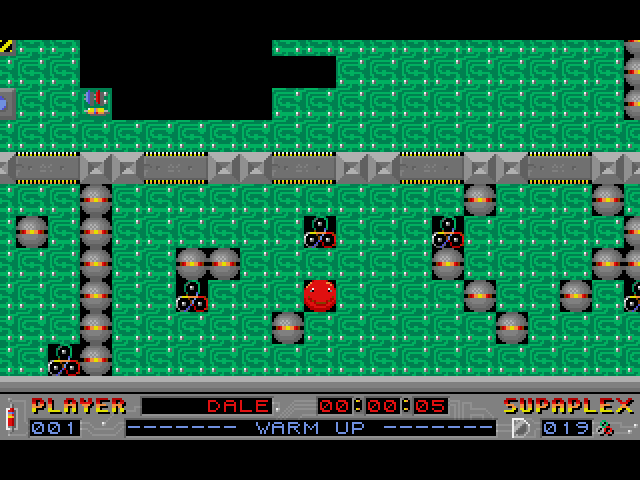
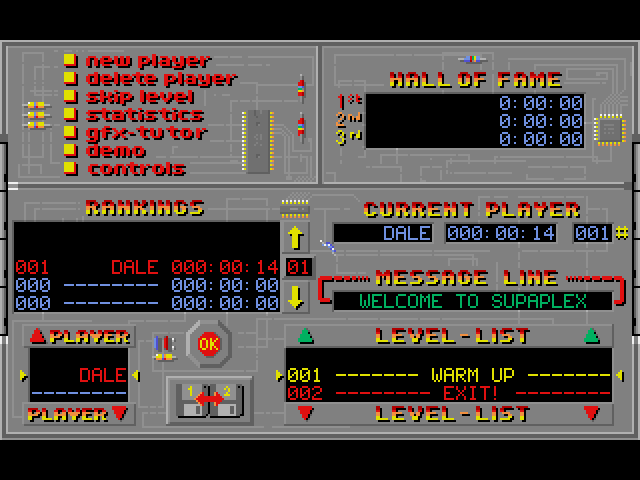
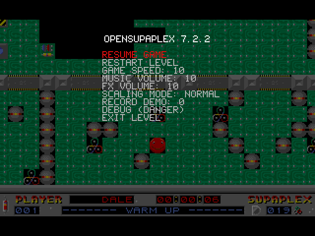

# OpenSupaplex

**Supaplex, the 1991 puzzle classic, on the Amiga.**

  

  
  

Captured from this build running on AmigaOS.

Guide Murphy through 111 levels of infotrons, zonks and snik snaks. OpenSupaplex is Sergio Padrino's faithful C re-creation of Supaplex from the original assembly, and this build runs it at the original 70 frames a second on the Amiga, with sound effects and ProTracker music.

## What you need

A 68040 with an FPU, AmigaOS 3.2 or later, AHI. AGA or an RTG card.

Supaplex is freeware: put the game's data files in the program's drawer.

## Controls

| Key | Does |
|---|---|
| Arrows or keypad | Move |
| Space + direction | Eat or push without moving |
| Esc | Leave the level, pause menu |
| F-keys, mouse | Menus |
| Help | F12 |
| Right Amiga + Q | Quit |

## What works

- The whole game at its original speed, AGA and RTG
- Sound effects and music (ProTracker MODs) through AHI
- Keyboard, mouse and pads

## Not in this build yet

- The XM tunes are replaced by MODs (see `amiga/music/README.md`)

## Building

The Amiga build, its make file and what was changed for the 68k are described in [AMIGA_PORT.md](AMIGA_PORT.md).

## Credits and licence

OpenSupaplex by Sergio Padrino ([upstream](https://github.com/sergiou87/open-supaplex)). Licence: GPL 3.

Amiga port by The AmiCradle Team.

The original project's README is [README.upstream.md](README.upstream.md).
